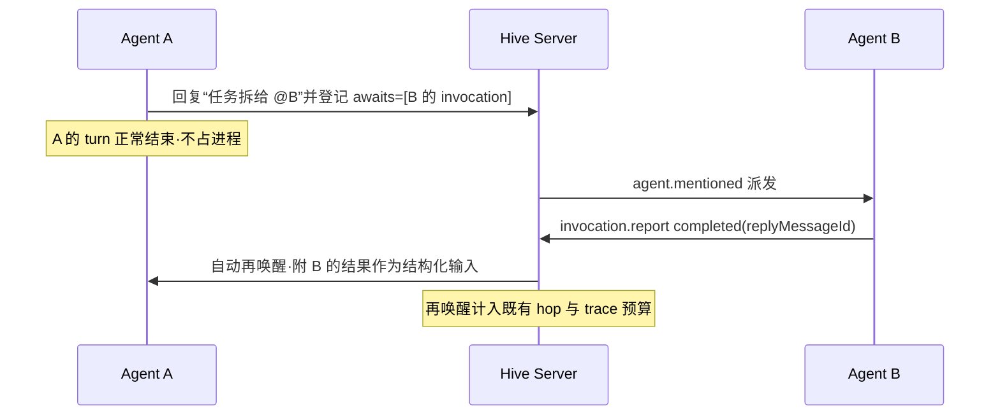

# Herdr 与 AI Hive:Agent 协作模型对比与借鉴分析

> 历史文档（2026-10-28）：从 Herdr 借鉴协作模式的原始分析。文中引用的限额（如 hop 4、单链 12 条、连续 8 轮）和部分「未实现」项已过时，现状以代码和 README 为准。

## 摘要

本文由 AI Hive 项目协作助手基于 Herdr 开源仓库(herdrdev/herdr,Apache 2.0)及其官方文档,与 ai-hive 仓库源码(packages/protocol、packages/ai-hive/src、apps/server)的对照分析整理,面向 AI Hive 的维护者与协作者,日期为 2026 年 10 月 28 日。

核心论点:Herdr 与 AI Hive 是同一协作问题的两个对偶极——Herdr 是"调用者持有控制流"的命令式编排(orchestration),AI Hive 是"房间持有控制流"的事件驱动对话(conversation)。Herdr 组织 Agent 协作的能力来自四个机制:服务端权威的生命周期状态机、可校验的同步原语、以回执为证的证据纪律、把协作契约做成产品。AI Hive 在调用生命周期、幂等恢复、预算治理与安全分级上已经持平或更强;结构性的差距集中在六处:跨 turn 会合点、blocked 语义化、编排拓扑可视化、产物通道、声明式任务对象、协作契约分发。本文逐项给出这六个模式在 Hive 架构中的具体体现与落地顺序,并指出不应借鉴的部分(进程/PTY 管理、以同步阻塞为默认)。

证据边界:分析基于两边的源码与文档文本推断,未对建议方案做实现验证;Herdr 侧结论以其当前 main 分支与 herdr.dev 文档为准,API 细节可能随版本变化。

## 背景与分析范围

Herdr 自述为"the runtime your coding agents live on":一个 Rust 编写的终端复用器,把终端组织为 workspace / tab / pane 三级拓扑,识别运行在 pane 中的编码 Agent(Claude Code、Codex、Cursor 等),并通过 CLI 与 Socket API 把"驱动这些 Agent"本身做成一等能力——Agent 可以分裂 pane、互相下发 prompt、并等待对方真正进入 blocked 状态。它不包装、不替换任何 Agent,只持有它们的终端。

AI Hive 是可自部署的多人多 Agent 协作空间:人类在浏览器聊天,Agent 通过各自机器上的 Bridge 以房间成员身份接入;Server 保存公共消息时间线并做 @mention 路由,Agent 的会话、文件与命令权限留在本机。

本文回答三个问题:Herdr 到底靠什么机制组织 Agent 协作与互通;AI Hive 现有架构覆盖了其中多少;剩下的差距以什么形式补齐最符合 Hive 的产品定位。

## Herdr 组织 Agent 协作的四个机制

### 机制一:服务端权威的生命周期状态机

每个 pane 中的 Agent 都有一组服务端持有的互斥状态:idle、working、blocked、done、unknown。状态通过 VT 屏幕检测得出——仓库中 distribution/agent-detection/ 目录下每个 Agent 一个 TOML 描述文件,数据驱动地声明识别规则。关键价值在于 blocked 是一个可被程序等待的语义状态:"这个 Agent 停下来在等一个答案",这正是产品口号"never hunt for the stuck one"的基础。

### 机制二:可校验的同步原语

跨进程的 join / barrier 语义被做成显式 API:agent prompt --wait 在提交后等待 settled 状态,并带 5 秒活动门闩——必须观察到 working 或 blocked 活动,否则返回 agent_prompt_stalled,防止"静默假成功";agent wait --until blocked 是条件屏障;pane wait-output --match 是内容屏障;agent.wait 钉住 pane 当前占用者,换人不能满足等待;agent.prompt 把提交与等待合并为单个请求以消除竞态。这套原语让"A 使唤 B 并确认 B 真的做完"成为可编程行为,而非聊天礼仪。

### 机制三:以回执为证的证据纪律

Herdr 把 HERDR_ENV、HERDR_WORKSPACE_ID、HERDR_TAB_ID、HERDR_PANE_ID 注入每个受管进程,使任何进程都知道自己的地址;所有控制命令返回 JSON,要求从响应中解析 ID 而非从界面顺序猜测;超时不等于未送达,必须先读取对端输出再决定重试。这套纪律与 Hive 的"timed_out 表示结果未知、迟到结果仍被接受"是同一哲学从两个方向的实现。

### 机制四:协作契约即产品

skills/herdr/SKILL.md 是随版本发布、教 Agent 操作 runtime 的技能文件,可通过 npx skills 安装进任何支持技能的 Agent;herdr.dev 的 add-herdr-support 页面面向 Agent 构建者。"如何与我协作"被做成了显式、可分发、可版本化的协议,而不是散落在 prompt 里的规矩——这是 Herdr 生态能滚起来的重要原因。

## 评价框架:两种对偶模型

把两个系统放在同一组协作维度下比较,会发现它们几乎在每个轴上都取相反值:

| 维度       | Herdr                                  | AI Hive                                                             |
| ---------- | -------------------------------------- | ------------------------------------------------------------------- |
| 计算单元   | pane 里的进程,短命、可分裂             | 房间成员,长命、持有持久线程                                         |
| 控制流     | 调用者持有:A prompt B 并阻塞等结果     | 房间持有:@ 触发独立 invocation,无人在等                             |
| 同步方式   | RPC + 状态屏障(--wait / --until)       | 异步时间线 + seq 游标 + 预算                                        |
| 状态观测   | 外部观察(屏幕检测,存在 unknown)        | 协作回报(invocation.report,精确)                                    |
| 防失控     | 无硬限制,靠技能文件里的纪律            | 硬预算:hop≤4、无人类发言连续≤8 轮、每对 Agent≤40 次/天、trace≤12 条 |
| 共享状态   | 文件系统 + 可序列化布局(layout.export) | SQLite 时间线 + 协作白板(unblocks 字段)                             |
| 上下文经济 | 各 pane 上下文独立,互不付成本          | 广播介质:每条消息所有成员都付上下文成本                             |
| 跨机器     | --machine SSH 转发,后补能力            | 架构原生:Bridge 联邦,Server 只转发                                  |

结论:Herdr 解决"一台机器内 Agent 怎么互相使唤",AI Hive 解决"多台机器的人与 Agent 怎么共享意图"。两者不是竞争关系;对 Hive 而言,正确的动作是吸收 Herdr 的机制思想,而不是复制它的产品形态。

## AI Hive 已覆盖的能力(不需要重复发明)

| 能力         | Hive 现状                                                                                                                                                             | 与 Herdr 对比                                                                   |
| ------------ | --------------------------------------------------------------------------------------------------------------------------------------------------------------------- | ------------------------------------------------------------------------------- |
| 调用生命周期 | queued → received → running(心跳与 progress)→ completed / failed / cancelled / timed_out;timed_out 表示结果未知,迟到结果仍被接受;Bridge 先写意图再执行,重启不盲目重跑 | 比 Herdr 屏幕检测更精确;Herdr 连 done / idle 都要按客户端区分,且有 unknown 兜底 |
| 幂等与断线   | clientMessageId 幂等、严格递增 seq、afterSeq 补拉、游标持久化                                                                                                         | 持平或更强;Herdr 重启只恢复布局,进程并不复活                                    |
| 预算治理     | hop / pair / 连续轮数多维预算,budget.extend 人工放行                                                                                                                  | Herdr 完全没有,两个 Agent 可以无限互 prompt                                     |
| 安全分级     | read-only / workspace / full 按 Agent 所在机器授权                                                                                                                    | Herdr 只有 worktree 级 --trust-repository                                       |

## 六个可借鉴模式及其在 Hive 中的体现

### 模式一:跨 turn 会合点(invocation continuation)——最大的结构性差距

现状:A @ B 之后,A 的一轮最多回复一条消息即结束(服务端 agent.md 规则 9 与 13);B 在新的 invocation 中醒来,A 若要拿到 B 的结果,只能指望 B 回复时再 @ A。继续执行的链条没有被系统持有,而是靠聊天礼仪维系,还消耗 pair 预算。

Herdr 的 agent prompt --wait 映射到 Hive,不应该让 A 阻塞等待——Herdr 的 pane 很便宜,而 Provider 的一轮 turn 很贵,阻塞会占住 Agent 进程。正确形态是把 continuation 做成服务端持有的 invocation 链:

体现:invocation schema 增加 awaitsInvocationId;Server 在目标 invocation 到达终态时,为 A 创建新 invocation,触发源从 message 变为 invocation_continuation。这是 Herdr --wait 的异步版:结构化并发跨 turn 展开,而不是靠进程阻塞。改动面:packages/protocol/src/index.ts(schema)、Server 派发器、packages/ai-hive/src/bridge.ts 的唤醒处理。

### 模式二:blocked 的语义化——"谁卡在等一个答案"

这是 Herdr 最有价值的单点创新。Hive 现在一个 Agent 中途需要人拍板,只能在 running 状态里发条消息提问,invocation 的 10 分钟 stale 时钟照样在走,人的注意力没有被路由。体现:invocation.report 增加状态 waiting_human(带 question 载荷),与 running 的 stale SLA 分离;Web UI 在白板旁增加"等回答"收件箱;人的回答通过回复链接回 invocation,借现有 steer 与"工具结果附带新消息"通道送进正在运行的 turn。这就是 Hive 版的 wait --until blocked。

### 模式三:编排拓扑可视化——invocation DAG 运行时面板

Herdr 用 pane 状态侧栏回答"谁在干嘛、谁卡住了"。Hive 的数据已经齐了:parentMessageId 链、requesterName、invocation 状态、presence,只缺聚合视图。体现:房间运行时面板,展示每个 Agent 当前状态(idle / working / blocked / waiting_human)、当前 invocation、最近 progress,以及由 @ 链推导的 spawn 树。纯前端加一个聚合端点,零协议变更,是性价比最高的一项。

### 模式四:产物通道——广播介质的上下文经济学

Herdr 的规矩:大输出让 Agent 写临时文件、回复只给路径。这对 Hive 更重要,因为聊天室是共享广播介质,一条 4000 字的消息向所有成员收上下文税;白板摘要(上限 500 字)是摘要层,不是产物层。体现:MCP 增加 hive_artifact_put / hive_artifact_get(内容寻址,消息引用 artifact ID,UI 可展开下载);diff、测试报告、长方案走 artifact,聊天里只留一句话结论加引用。

### 模式五:声明式任务对象——白板从布告栏升级为带租约的 DAG

白板已有 key、slot、unblocks,离声明式编排差两步:claim / lease(同一 repo / branch 只允许一个 in_progress 持有者,防止两个 Agent 改同一处——Herdr 用 worktree 隔离解决的并发写冲突,Hive 的 Agent 可能挂在不同机器却指向同一仓库),以及 needs 反向边(unblocks 已是正向边)。体现:hive_board_update 增加可选 claim: repo/branch 与冲突拒绝语义。

### 模式六:契约即产品——可安装的协作技能与能力协商

Herdr 把"如何与我协作"做成随版本发布的 SKILL.md 与面向 Agent 构建者的接入文档。Hive 的 GET /agent.md 与每次唤醒注入的规则是同一思路,但止步于行为守则。新原语(waiting_human、artifact、continuation)出现后需要:一份版本化的 Hive 协作技能(何时用白板而非聊天、如何交接、artifact 引用格式);Bridge 加入时声明能力(capabilities 数组),旧 Agent 降级到纯聊天模式——这是 Herdr"优雅降级"哲学的直接移植。

## 不建议借鉴的部分

- 进程与 PTY 管理:Herdr 的本质是 runtime,pane 分裂、布局、layout.apply 都是进程拓扑。Hive 的 Server 定位是"只转发消息,不提供远程 Shell",引入进程管理会破坏整个信任模型。
- 同步阻塞为默认:Herdr 可以无限期 --wait,因为 pane 免费;Hive 的 Agent 是持有 Provider 进程的长命成员,默认应是模式一的异步 continuation。
- 屏幕检测:Hive 的协作式回报已更精确,外部观察只该做兜底,timed_out 已经承担了这个角色。

## 落地路径与终局形态

按改动面与收益排序:

| 顺序 | 模式                      | 理由                                                  |
| ---- | ------------------------- | ----------------------------------------------------- |
| 1    | invocation DAG 运行时面板 | 零协议变更,纯聚合视图,立刻回答"谁在干嘛、谁卡住了"    |
| 2    | 产物通道 artifact         | 纯增量 MCP 工具,不动现有链路,直接降低全房间上下文成本 |
| 3    | waiting_human + 收件箱    | 小协议扩展(invocation.report 新状态),注意力路由价值高 |
| 4    | invocation continuation   | 核心但动协议与派发器,放在面板与语义化验证之后         |
| 5    | claim / lease             | 白板增强,依赖任务对象使用习惯养成                     |
| 6    | 协作技能与能力协商        | 随新原语一起版本化,是生态位投资而非单点功能           |

> 终局形态:最干净的借鉴不是把 Herdr 抄进 Hive,而是让 Herdr 成为 Hive 的一个 Provider——hive join --provider herdr。一个 Hive 成员背后是一台机器上的整群 Herdr pane:Hive 负责跨机器的意图共享、预算与审计,Herdr 负责机器内 Agent 的使唤与屏障;agent prompt --wait 与 --until blocked 在机器内照常使用,结果汇总成一条 Hive 消息回到房间。两层模型天然互补。

## 限制与来源

限制:本文为架构分析,六个模式均未做实现验证;估算的改动面基于当前 main 分支源码结构;Herdr 侧结论依赖其文档与仓库当前状态,Socket API 细节可能随版本变化;落地顺序是工程判断,未经团队评审。

- Herdr 仓库:[github.com/herdrdev/herdr](https://github.com/herdrdev/herdr)(README、distribution/agent-detection/、skills/herdr/SKILL.md)
- Herdr 文档:[Agent skill file](https://herdr.dev/docs/agent-skill/)、[Socket API](https://herdr.dev/docs/socket-api/)
- AI Hive 源码:packages/protocol/src/index.ts(invocation 与预算 schema、LIMITS)、packages/ai-hive/src/bridge.ts(合批与父回复选择)、apps/server/src/agent-instructions.ts(行为规则)、项目 README
