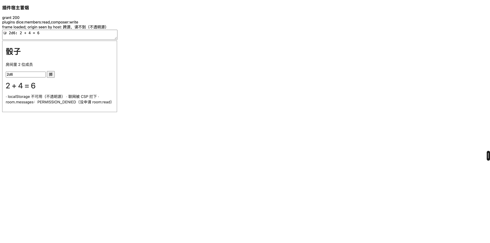

# SuperHive 插件系统：调研、方案与第一阶段原型

> 起因：rd #6295「项目能不能支持插件系统，让用户做各种插件来丰富它」。
> 本文是方案和原型，不合入 main。原型在分支 `feat/rd-claude3-plugin-system-design`。

## 结论先说

- **能做，但要按风险分层开放。** SuperHive 的插件能碰到三样要命的东西：房间内容（含访客和远程房间里的对话）、令牌（join token、房主令牌、运行时 API key）、本机终端（Agent 本来就能跑命令）。所以不能学 Obsidian 那样「插件和应用同权」，要学 Figma：**插件代码不和宿主同进程、同源，只能通过一条受检查的消息通道要数据**。
- **第一阶段只开放三类扩展点**：网页面板（sandbox iframe）、斜杠命令（交给面板处理）、给 Agent 用的 MCP 工具（声明式，房主确认后写入运行时配置）。全部由一份清单文件 `superhive-plugin.json` 声明，权限默认全无，房主在本机批准，随时撤销。
- **原型已证明可行**：清单校验、本机批准 / 撤销、无同源沙箱面板、postMessage 权限网关、斜杠命令分发都跑通了，并在真实 Chrome 里验证面板读不到宿主 localStorage、联不了网、拿不到没申请的数据（见文末截图）。
- **服务端插件（事件钩子、IM 连接器、自定义运行时）放到第三阶段，而且必须是独立进程**，走和本机 Agent 相同的「凭令牌连回 Server」模式，不在 Server 进程里 `import` 第三方代码。

## 一、成熟做法调研

|              | 形态                                                                                               | 加载与隔离                                                                                                                                                                         | 权限声明                                                                                                                                             | 分发与更新                                                                                              | 版本兼容                     | 签名与审核                                                                                                        |
| ------------ | -------------------------------------------------------------------------------------------------- | ---------------------------------------------------------------------------------------------------------------------------------------------------------------------------------- | ---------------------------------------------------------------------------------------------------------------------------------------------------- | ------------------------------------------------------------------------------------------------------- | ---------------------------- | ----------------------------------------------------------------------------------------------------------------- |
| **VS Code**  | `package.json` + `contributes`（命令、视图、菜单…）+ `activationEvents`                            | 所有扩展跑在独立的 **Extension Host 进程**（Node，可在本地 / 远程 / Web Worker）；和 UI 隔离，但**扩展之间、扩展和用户文件之间不隔离**                                             | 没有细粒度权限；用 **Workspace Trust**：不受信任的工作区进 Restricted Mode，扩展通过 `capabilities.untrustedWorkspaces` 声明自己在受限模式下支不支持 | Marketplace 自动更新                                                                                    | `engines.vscode` 范围        | Marketplace 对包签名、做恶意软件扫描和沙箱「洁净室」动态检测；1.97 起首次装第三方发布者的扩展要确认「信任发布者」 |
| **Obsidian** | `manifest.json`（id、version、`minAppVersion`、`isDesktopOnly`）+ `main.js`                        | **不隔离**，和应用同进程同权限；官方明说「无法可靠地限制插件权限」，插件能读写电脑上的文件、联网、装程序                                                                           | 无                                                                                                                                                   | 社区目录收录 GitHub Release；默认开启「受限模式」，用户要手动关掉才能装社区插件                         | `minAppVersion`              | 首次提交人工审核；之后的更新不逐一审，热门、精选、被举报的继续人工复查                                            |
| **Raycast**  | `package.json` 清单（commands、preferences、tools）                                                | 所有扩展跑在**一个 Node 子进程**里，和主程序走 RPC；扩展之间不隔离                                                                                                                 | 需要系统能力时由 macOS 弹权限；凭据放 Keychain、偏好存在本地加密库                                                                                   | **全部开源在一个公开仓库**，以 PR 形式提交，官方和社区共同代码审查，CI 校验清单、作者、构建；合入即发布 | 有 API 版本，旧 API 标记弃用 | 靠「全部开源 + 人工 review」代替签名                                                                              |
| **Figma**    | `manifest.json`（`main`、`ui`、`networkAccess`、`permissions`、`documentAccess`）                  | **最值得借鉴**：插件主代码跑在主线程的最小 JS 沙箱里（没有 DOM、fetch、setTimeout），只能操作文档；UI 跑在 **iframe** 里，有浏览器 API 但碰不到文档；两边只能 **postMessage**      | `networkAccess.allowedDomains`（可写 `["none"]`）+ `reasoning` 说明理由，由 CSP 强制；`permissions` 声明要读当前用户、团队库等                       | 社区发布需审核；更新也要再审                                                                            | `api` 版本号                 | 人工审核，按指南检查网络访问、数据用途                                                                            |
| **Grafana**  | `plugin.json`（type、`dependencies.grafanaDependency`、`backend`、`executable`）                   | 前端插件和 Grafana 同页同源（曾做 Frontend Sandbox 公测，**已弃用、13.4 移除**——同页 JS 沙箱很难做牢）；**后端插件是独立进程**，基于 HashiCorp go-plugin 走 gRPC，崩了不拖垮主进程 | 无细粒度权限                                                                                                                                         | 官方目录；`grafana cli` 安装 / 更新                                                                     | `grafanaDependency` 范围     | **强制签名**：private / community / commercial 三级；未签名的默认拒绝加载，要在配置里显式放行（日志告警）         |
| **MCP**      | Server 暴露 tools / resources / prompts；工具有 `inputSchema`、`annotations`（只读、破坏性等提示） | Server 是独立进程（stdio）或远程服务（HTTP）                                                                                                                                       | 远程 Server 用 OAuth 2.1：客户端必须做 PKCE 和 RFC 8707 Resource Indicators，Server 必须校验令牌的受众是自己，**禁止令牌透传**                       | 官方 Registry（元数据）+ npm / PyPI 等                                                                  | 协议版本协商                 | 无统一签名；规范要求**始终有人在回路里，能拒绝工具调用**，敏感操作前弹确认                                        |

几条共同教训：

1. **同进程同源 = 没有权限系统**（Obsidian、Grafana 前端、VS Code 扩展之间）。真正能执行权限的只有「进程边界」或「浏览器源边界」（Figma iframe、Grafana 后端、MCP stdio）。
2. **Grafana 放弃同页 JS 沙箱**说明：别在宿主页面里用 Proxy / Realm 做隔离，直接用 iframe 的跨源边界。
3. **清单声明 + 人确认**是通用做法；声明的能力要被**机制强制**（Figma 用 CSP 强制 `allowedDomains`），不能只是展示给人看。
4. **签名 / 审核解决的是分发链路**，不是运行时隔离。社区规模小的时候，Raycast 式「开源 + PR 审核」最省事。
5. **MCP 工具描述本身是提示注入面**（工具描述里藏指令、装上后悄悄改描述的 rug pull）。给 Agent 的工具一定要让人看见完整描述，变了要重新确认。

## 二、扩展点评估（价值 × 风险）

| 扩展点                     | 价值                                                   | 风险                                                                                                                    | 建议                                                                                                                       |
| -------------------------- | ------------------------------------------------------ | ----------------------------------------------------------------------------------------------------------------------- | -------------------------------------------------------------------------------------------------------------------------- |
| **网页面板 / 右侧标签页**  | 高：看板、统计、小工具、外部系统嵌入，用户感知最强     | 低（在无同源 iframe 里、只能经网关要数据时）                                                                            | **第一阶段**                                                                                                               |
| **斜杠命令**               | 中高：`/roll`、`/deploy-status` 这类快捷入口           | 低：只是把参数交给插件自己的面板；不替人发消息                                                                          | **第一阶段**（命令由面板处理）                                                                                             |
| **给 Agent 用的 MCP 工具** | 高：直接扩展 Agent 能力，生态现成                      | 中：MCP Server 是本机进程，能做的事等于本机用户；但这和「房主在运行时配置里自己加 MCP」完全一样，SuperHive 已有这个入口 | **第一阶段**，但只做「声明 + 房主确认后写进运行时配置」，不由 SuperHive 自动执行                                           |
| **主题**                   | 中：个性化                                             | 很低（纯 CSS 变量，不跑脚本）                                                                                           | **第二阶段**，只允许覆盖设计 token，不允许任意 CSS（防止盖住确认弹窗做钓鱼）                                               |
| **消息渲染与卡片**         | 中高：把机器输出渲染成表格、图表、按钮                 | 中：消息里的卡片会出现在每个人（含访客）面前，按钮可被诱导点击                                                          | **第二阶段**：卡片用声明式 JSON（类似 Slack Block Kit / 飞书卡片），由宿主渲染；要交互就开插件面板，不在消息流里跑插件脚本 |
| **服务端事件钩子**         | 高：自动化（消息进来就转工单、完成任务就通知）         | 高：能看到所有房间、所有消息                                                                                            | **第三阶段**，独立进程 + 订阅范围声明（哪些房间、哪些事件）                                                                |
| **IM 连接器**              | 中：目前有飞书、微信，社区可能要 Slack、Telegram、钉钉 | 高：要存第三方凭据、要收发所有消息                                                                                      | **第三阶段**，复用服务端插件进程模型；凭据放 SuperHive 已有的 `secret-box`，插件拿不到原值                                 |
| **自定义 Agent 运行时**    | 中：接新的 CLI / 模型                                  | 高：本身就是本机任意执行                                                                                                | **不做成插件**。现在 `hive agent join` 已经能让任何实现了协议的进程加入房间，这就是「运行时插件」；补文档和协议 SDK 即可   |

## 三、安全设计

### 1. 默认权限：什么都没有

- 清单里的 `permissions` 只是**申请**。没批准的插件：房间里看不到、面板地址发不出、文件取不到。
- 第一阶段权限表很小，且都是**只读或「只填不发」**：
  - `room:read`：读当前房间最近的消息（当前查看者本来就能看到的、网页里已有的数据，最多 50 条）
  - `members:read`：读成员名字、类型、在线状态
  - `composer:write`：往输入框里**填**文字，发不发由人决定
- 不在表里的权限一律拒绝（`superhive-plugin.json` 用 `strict` 校验，写了不认识的字段或权限直接判无效），不做「先放行再说」。
- **永远不给插件的东西**：join token、房主令牌、访客会话令牌、运行时 API key、本机终端、文件系统、以人的身份发消息、调用 `hive_*` 工具。这些即使将来开放，也只能以「宿主替插件做、每次让人确认」的形式出现。

### 2. 网页插件怎么隔离：无同源 sandbox iframe + postMessage 网关

不在宿主页面里跑插件脚本（Grafana 已证明同页沙箱做不牢）。原型的做法：

- 面板经 `POST /api/rooms/:roomId/plugins/:id/panels/:panel/frame` 换一个**一小时有效的随机前缀**，iframe 加载 `/api/plugin-frames/<token>/panel.html`，相对路径的脚本和样式挂在同一前缀下。iframe 带不了 Authorization 头，所以不用 Cookie、不用令牌进 URL。
- 响应头 CSP（服务端强制，插件改不了）：
  - `sandbox allow-scripts allow-forms`，**不给 `allow-same-origin`**：面板是不透明源，读不到网页的 localStorage（登录凭据就存在那里）、Cookie，也不能带凭据调 `/api`；
  - `connect-src 'none'`：第一阶段不能联网（第二阶段加 `network` 权限，按域名放行，学 Figma 的 `allowedDomains` + `reasoning`）；
  - `form-action 'none'`、`base-uri 'none'`、`frame-ancestors` 只允许宿主页。
- 宿主侧网关（`apps/web/src/plugin-host.ts`）：按 `event.source === iframe.contentWindow` 认面板，忽略其他来源；方法白名单 + 每个方法对应一条权限，**每次调用都现查**；参数限长（文字 ≤ 4000 字）。
- 撤销批准后，已经打开的面板再取任何文件都会 404（每次取文件都重新核对启用状态）。
- 插件文件只按扩展名白名单给（html/js/css/json/图片/字体），解析真实路径后必须仍在插件目录里（防 `../` 和软链逃逸），不按内容猜类型，带 `nosniff`。

实测（真实 Chrome，临时端口，见截图）：面板正常运行、成员数读到、`/roll 2d6` 结果填进了输入框；`room.messages` 因为没申请返回 `PERMISSION_DENIED`；`localStorage` 抛错（不透明源）；`fetch` 被 CSP 拦下；宿主读 `iframe.contentWindow.location` 报跨源。

实测中踩到一个坑：面板是不透明源，它加载**自己的** `sdk.js`、`panel.css` 也算跨源请求，`Cross-Origin-Resource-Policy: same-origin` 会把它们全拦掉、面板一片空白。改成 `cross-origin`，访问控制靠一次性前缀。

### 3. 服务端插件要不要放进独立进程：要，而且必须

- 不在 Server 进程里加载第三方代码。Server 进程拿着数据库（所有房间的消息）、join token、IM 密钥、运行时 API key，同进程等于全给。
- 第三阶段的服务端插件按 **Grafana 后端插件 / MCP stdio** 的模式：Server 拉起独立子进程（或插件自己作为客户端连进来），只通过受控的 RPC / WebSocket 订阅它声明过、房主批准过的事件和房间。
- SuperHive 已有现成的样板：本机 Agent 就是这样——独立进程、凭令牌连回 Server、Server 按身份限定它能看到什么。服务端插件可以复用这套连接和身份模型（一种新的 participant 类型「插件」），而不是另造一套。
- 可以进一步给子进程加 OS 级限制（macOS `sandbox-exec`、Linux namespaces），但这是加固，不是第一道防线。

### 4. 访客、远程房间里插件能做什么

- **访客默认看不到任何插件**：清单要写 `guests: true`，并且房主批准时能看到这一项，访客才会看到面板和命令。原型里 `/api/rooms/:roomId/plugins` 对访客只返回 `guests: true` 的插件，访客也申请不到面板地址。
- 访客用插件时，网关给的数据范围就是**访客本来能看到的**（网页里已有的数据），插件不会因此多看到什么。
- **远程房间（加入别人的 Server）**：插件属于 Server，不属于客户端。你加入别人的房间，用的是**对方** Server 批准过的插件，跑在你浏览器里的无同源 iframe 中，同样拿不到你的令牌；你自己机器上装的插件不会带进别人的房间。
- 消息卡片（第二阶段）会被所有人看到，所以卡片只能是声明式 JSON，由宿主渲染。

### 5. 安装和撤销授权

- **安装**（第一阶段）：把插件目录放进插件目录（原型里是 `HIVE_PLUGINS_DIR`，正式版放数据目录下的 `plugins/<id>/`）。目录名必须等于清单 `id`；`engines.superhive` 不满足当前版本就不加载（认不出的版本范围也当不兼容）。
- **批准**：只有本机房主能批准（复用 `/api/local/*` 的 local 级鉴权，房主的其他设备、访客、Agent 令牌都不行），批准时展示：申请的权限、`guests`、要注册的 MCP Server 命令和描述。批准记录在 `plugins/.grants.json`（0600），写明批准的是哪个版本、哪些权限。
- **升级**：新版本**没多申请权限**照常可用；**多申请了**就整体停用，等房主重新批准（VS Code、Chrome 扩展都是这个规矩）。
- **撤销**：`DELETE /api/local/plugins/:id/grant`，立即生效，已打开的面板再取文件就 404。
- **MCP 工具**：批准插件时**不自动**写进运行时配置。房主在「Agent 运行时」面板里看到插件提供的 MCP，逐个确认后写入（走已有的 `/api/local/runtime-config/:provider/mcp` 接口，有审计）；工具描述变了要重新确认，防 rug pull。
- 所有批准、撤销都记审计日志（原型先写 Server 日志）。
- 分发（第二阶段起）：先学 Raycast——官方仓库收 PR，所有插件开源、人工 review、CI 校验清单；之后再考虑签名（Grafana 的三级签名）。

## 四、分阶段路线

### 第一阶段：最小可用（已实现，见第六节）

- 清单 `superhive-plugin.json`：`id / name / version / engines.superhive / permissions / guests / contributes.{panels, commands, mcpServers}`。
- 本机管理：列出、批准、撤销（接口已有，**网页管理界面待做**：设置里加「插件」页）。
- 网页面板：右侧栏加插件标签（`SidePanelTab` 从固定两项变成 `members | whiteboard | plugin:<id>/<panel>`），iframe 加载 + 网关（网关已有，**接进侧栏待做**）。
- 斜杠命令：输入框里 `/name args` 命中已启用插件的命令时，打开对应面板并把参数交给它（匹配函数已有，**接进输入框待做**）；没命中的照常当普通消息发。
- MCP 工具：清单声明，在运行时面板里显示「来自插件 xx」，房主逐个确认后写进配置。
- 文档：写插件的指南（清单字段、SDK、权限表、示例插件）。

估计：在原型基础上补网页三处接线、管理页和文档，约 2～3 天。

### 第二阶段：更有用

- 权限：`network`（按域名，学 Figma）、`storage`（宿主代存的每插件 KV，按房间隔离）、`room:write-card`（发声明式卡片，每次让人确认或限速）。
- 主题：只允许覆盖设计 token。
- 消息卡片：声明式 JSON 渲染，按钮回调到插件面板。
- 分发：官方插件仓库（PR 审核），`hive plugin install <id>` 从仓库下载、校验 sha256；更新时对比权限差异。

### 第三阶段：服务端扩展

- 服务端插件进程：作为「插件」类型的 participant 连回 Server，订阅声明过的事件；崩了自动重启、不影响 Server。
- IM 连接器迁到这个模型；凭据由宿主保管，插件只拿到发 / 收的能力。
- 签名（community / private 两级），未签名的需要房主显式放行。

**明确不做**：在 Server 或网页主页面里直接执行第三方 JS；让插件以人的身份发消息；把令牌交给插件。

## 五、原型说明

分支 `feat/rd-claude3-plugin-system-design`，默认关闭，设了 `HIVE_PLUGINS_DIR` 才开放。

| 文件                                       | 内容                                                                                                                                 |
| ------------------------------------------ | ------------------------------------------------------------------------------------------------------------------------------------ |
| `packages/protocol/src/plugin-manifest.ts` | 清单 schema（strict）、权限表、批准记录、postMessage 协议类型、方法 → 权限映射、`engines` 版本范围判断                               |
| `apps/server/src/plugins.ts`               | `PluginRegistry`（扫目录、校验、批准 / 撤销、写盘、取文件防逃逸）；本机管理接口；房间接口（列表、换面板前缀、取面板文件 + 沙箱 CSP） |
| `apps/web/src/plugin-host.ts`              | 宿主侧网关（认来源、白名单、现查权限、限长）和斜杠命令匹配                                                                           |
| `examples/plugins/dice/`                   | 示例插件：掷骰子面板 + `/roll` 命令，自带 20 行的 SDK；面板里顺便演示三种隔离                                                        |

接口：

- `GET /api/local/plugins`、`POST|DELETE /api/local/plugins/:id/grant`（本机房主）
- `GET /api/rooms/:roomId/plugins`（能进房间的人；访客只看 `guests: true`）
- `POST /api/rooms/:roomId/plugins/:id/panels/:panel/frame` → `{ url }`
- `GET /api/plugin-frames/:token/*`

测试：protocol 14 个（清单校验、路径逃逸、版本范围）、server 8 个（未批准不可见、只有本机能批准、CSP、撤销即失效、访客不可见、升级多申请权限要重批、批准写盘、`../` 和软链逃逸）、web 5 个（权限拒绝、来源校验、参数限长、命令匹配）。

浏览器实测用的是临时端口、临时数据目录和一个最小宿主页，**没有接进真正的网页侧栏和输入框**，这是第一阶段剩下的工作。

## 六、第一阶段实现（rd-claude #6480）

原型之上补齐了网页三处接线、管理页、MCP 扩展点和文档，默认开启（`HIVE_PLUGINS=0` 关闭）：

- **插件目录**：默认在数据目录的 `plugins/`，`HIVE_PLUGINS_DIR` 可换；`engines.superhive` 按 superhive 包版本核对。批准记录按文件修改时间缓存，房主手动删改 `.grants.json` 也随即生效。
- **侧栏**：当前房间有已批准的面板时，右侧栏多出「插件」标签页（没有就不出现，撤销后自动退回「成员」）；多个面板时上面一排切换。iframe 双保险：`sandbox="allow-scripts allow-forms"` 属性 + 响应头 CSP sandbox，`connect-src 'none'`。
- **斜杠命令**：`useComposer` 发送前问一下插件，认领了就清空输入框、不发出去，切到对应面板并在面板加载完后把 `{ name, args }` 发过去；没认领的、带附件的照常发。结果只能经 `composer.insert` 填进输入框。
- **即时撤销**：批准、撤销、MCP 确认后 Server 给人类成员的连接推 `plugins.changed`，网页重新取插件列表，失效的面板立即卸掉；已发出的面板地址本来就每次现查批准状态。
- **设置 · 插件**：只给 Server 所在电脑上的本机房主（和「Agent 运行时」同一条件，接口也是 local 级）。列出插件、每条权限的中英文说明、提供的面板和命令、访客是否可见；升级多申请的权限标「新增」并要求重新批准；撤销要二次确认。
- **MCP 扩展点**：`PUT /api/local/plugins/:id/mcp/:name { providers }`。命令和参数按插件目录解析（`./` 开头的换成绝对路径、不能跳出插件目录，其余当 PATH 上的程序名，不经过 shell），经 `RuntimeConfigStore.putMcp` 写进所选运行时的全局 MCP 配置，名字 `plugin-<id>-<name>`；部分运行时写失败时撤回这次写入的；清单改了命令标「要重新确认」；撤销插件时一并 `deleteMcp`。示例插件带了一个零依赖的 stdio MCP（`roll_dice`）。
- **文档**：文档站「使用指南 · 插件开发」中英文两页。

尚未做的（留给第二阶段）：输入 `/` 时的命令补全提示；面板里的 `storage` / `network` 权限；插件分发与签名。

## 参考链接

- VS Code Extension Host：https://code.visualstudio.com/api/advanced-topics/extension-host
- VS Code Extension Manifest：https://code.visualstudio.com/api/references/extension-manifest
- VS Code Workspace Trust：https://code.visualstudio.com/api/extension-guides/workspace-trust
- VS Code Extension runtime security：https://code.visualstudio.com/docs/configure/extensions/extension-runtime-security
- Obsidian Manifest：https://docs.obsidian.md/Reference/Manifest
- Obsidian Plugin security：https://help.obsidian.md/plugin-security
- Obsidian Submit your plugin：https://docs.obsidian.md/Plugins/Releasing/Submit+your+plugin
- Raycast Manifest：https://developers.raycast.com/information/manifest
- Raycast Security：https://developers.raycast.com/information/security
- Raycast Publish an Extension：https://developers.raycast.com/basics/publish-an-extension
- Raycast Versioning：https://developers.raycast.com/information/versioning
- Figma How Plugins Run：https://developers.figma.com/docs/plugins/how-plugins-run/
- Figma Plugin Manifest：https://developers.figma.com/docs/plugins/manifest/
- Figma Making Network Requests：https://developers.figma.com/docs/plugins/making-network-requests/
- Figma Plugin and widget review guidelines：https://help.figma.com/hc/en-us/articles/360039958914
- Grafana Plugin backend system：https://grafana.com/developers/plugin-tools/key-concepts/backend-plugins/
- Grafana plugin.json：https://grafana.com/developers/plugin-tools/reference/plugin-json
- Grafana Plugin signatures：https://grafana.com/docs/grafana/latest/administration/plugin-management/plugin-sign/
- Grafana Sign a plugin：https://grafana.com/developers/plugin-tools/publish-a-plugin/sign-a-plugin
- Grafana Plugins Frontend Sandbox（已弃用）：https://grafana.com/docs/grafana/latest/administration/plugin-management/plugin-frontend-sandbox/
- MCP Tools：https://modelcontextprotocol.io/specification/2025-06-18/server/tools
- MCP Authorization：https://modelcontextprotocol.io/specification/2025-06-18/basic/authorization
- MCP Security Best Practices：https://modelcontextprotocol.io/specification/2025-06-18/basic/security_best_practices
  （MCP 规范站在本机测试时访问超时，内容按 GitHub 上的规范源文件核对：https://github.com/modelcontextprotocol/modelcontextprotocol/tree/main/docs/specification/2025-06-18）
- MDN iframe sandbox：https://developer.mozilla.org/en-US/docs/Web/HTML/Element/iframe#sandbox
